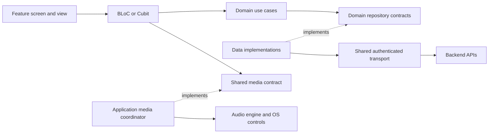

# Architecture Spine — TellPal Mobile Replacement

## Design Paradigm

One Flutter application using feature-first Clean Architecture and the `flutter-scalable-app` skill under ADR-0018. Features own `presentation`, `domain` and `data`; presentation calls domain use cases and data implements domain repository contracts. Domain business rules depend on neither Flutter, BLoC, routing nor infrastructure implementations. Shared facilities provide identity, navigation, networking, media and diagnostics. Introduce each boundary with its first consuming capability.



ADR-0018 supersedes the earlier Riverpod and `go_router` selections. This is the production target, not a claim that the existing media PoC already implements it. The installed skill references guide implementation; backend contracts and existing product safeguards remain authoritative.

## Invariants & Rules

### AD-1 — One feature-first Flutter codebase [ADOPTED]

- **Binds:** All mobile features and store-update delivery.
- **Prevents:** Competing Android/iOS implementations or feature logic scattering across global horizontal folders.
- **Rule:** Evolve `app/mobile` into the sole production client. Each feature owns `presentation` (screens, views, widgets, BLoCs/Cubits), `domain` (entities, repository interfaces, use cases) and `data` (models, datasources, repository implementations). Presentation depends on domain; data implements domain contracts; domain never imports data or platform adapters. The composition root wires implementations. Domain may use pure-Dart value types and DI annotation metadata, but not runtime container lookup. The PoC entry screen and test credentials remain development-only.

### AD-2 — One state owner per feature capability [ADOPTED]

- **Binds:** Authentication, catalog, reader, profile, paywall and migration UI.
- **Prevents:** Conflicting copies of state, screen-specific loading/error conventions and business decisions inside widgets.
- **Rule:** Use `flutter_bloc` with one BLoC/Cubit state owner per feature capability instance; use BLoC for event-driven/concurrent flows and Cubit for simple linear state. Events and states use Freezed; represent loading, empty, error, retry and loaded outcomes as applicable. Widgets dispatch actions and render immutable state; use BlocSelector for partial-state consumption and BlocListener for one-time UI effects. Business operations call injected domain use cases, never HTTP or data implementations. Keep ephemeral widget state local without duplicating BLoC-owned state. Define ordering/cancellation for competing actions and reject results for obsolete account, language, request or media-session generations; changing libraries does not provide this automatically.

### AD-3 — One application-scoped media session [ADOPTED]

- **Binds:** Illustrated reading, full-story narration, meditation, lullaby and system playback controls.
- **Prevents:** Overlapping players, stale page completion, playback loss on route replacement and contradictory background controls.
- **Rule:** A single media coordinator owns the logical session, serializes takeovers/source changes, rejects stale commands and completions, and is the sole producer of playback progress/completion transitions. It may coordinate separate narration and music channels; it must not permit unrelated sessions to overlap. Feature BLoCs/Cubits observe its shared contract and issue commands; they do not create players or own playback completion. Use `just_audio` for audio, `audio_service` for background/system controls and `audio_session` for interruptions. The coordinator owns player disposal and the admitted media revision; route disposal does not dispose the session or its active assets. Account change stops protected playback before the next account becomes ready. Preserve the PRD's loop, interruption, background and cold-relaunch behaviors on both platforms.

### AD-4 — Backend-owned account migration [ADOPTED]

- **Binds:** Registered and anonymous upgrades, second devices, retained user data.
- **Prevents:** Duplicate imports, lost local records, new data overwritten by old data and repeated migration on later-upgraded devices.
- **Rule:** Firebase Auth establishes identity; backend maps the verified UID to the canonical application user and owns idempotent account migration and its terminal status. The client gates normal use on verified persisted completion and exposes pending/retry states. Device-only anonymous data is imported separately with a stable operation identity and retained until a durable receipt confirms its disposition; an accepted upload is not completion. A later-upgraded device never restarts completed account migration; old-version devices keep using the old backend without continuous synchronization. Anonymous-to-new-account transfer and existing-account sign-in are distinct paths; no automatic merge into an existing account. New-system-only account deletion must leave the shared legacy identity usable and prevent remigration of deleted data.

### AD-5 — In-place update compatibility is an early gate [ADOPTED]

- **Binds:** Product app identity, signing, local data access and FR-29.
- **Prevents:** A working fresh install that cannot replace the live app or read migration inputs.
- **Rule:** Before auth/migration feature stories, verify the live Android application ID, iOS bundle ID and approved signing/provisioning; then prove representative signed in-place upgrades on both platforms can read retained local records and sessions. The documented legacy IDs are `com.scoustech.interactive_short_kid_stories_tellpal` (Android) and `com.scoustech.interactiveShortKidStoriesTellpal` (iOS). The PoC IDs are experimental and do not satisfy this gate.

### AD-6 — Central navigation from authoritative session state [ADOPTED]

- **Binds:** First launch, sign-in, migration gate, tabs, detail and player entry.
- **Prevents:** Feature-local redirects, inconsistent back stacks and normal catalog access during unfinished migration.
- **Rule:** One application-scoped AppSessionBloc projects verified identity, backend user, migration and access into signed-out, resolving, migration-pending/failed, ready and account-switching states. One `auto_route` AppRouter admits routes from this projection; guards reevaluate when session state changes and cannot retain stale admission. Features use generated routes and `context.router`, not direct Navigator calls or local auth redirects. Pass stable identifiers and required scalar context (experience, language, revision), never full entities or credentials; resolve and authorize at the destination. During account change, invalidate old async results, stop protected media, clear account-scoped state/cache, then admit the new account only after backend resolution. Navigation never replaces server authorization. Preserve independent tab stacks and reference deep links, including guarded entry after cold launch.

### AD-7 — One authenticated transport, typed feature adapters [ADOPTED]

- **Binds:** Every protected backend call and media manifest request.
- **Prevents:** Inconsistent token attachment, timeout/error handling and network calls from widgets.
- **Rule:** The shared transport obtains a current Firebase ID token, attaches it to protected calls and normalizes authentication, timeout and network failures. Feature data sources and models map verified contracts; repository implementations return domain entities through domain interfaces using `Either<Failure, T>` (dartz), wrapped in Future or Stream as required. Use cases depend on these interfaces; DTO JSON serialization stays in data (`json_serializable`, models extending domain entities). Retry mutations only with stable idempotency identity; stale-account responses cannot update current state. Start with handwritten typed clients and contract tests; reassess OpenAPI generation when contracts stabilize. Never ship the allowlisted PoC endpoint, test-token UI or development cleartext exception as production access.

### AD-8 — Separate durable user data from evictable media [ADOPTED]

- **Binds:** Profile/progress, device-local migration, cache, offline foundation and account switching.
- **Prevents:** Deleting migration input with cache cleanup, showing another account's data or treating cached media as a protected entitlement.
- **Rule:** Backend owns application profile, progress and access decisions; Firebase owns authentication. Locally preserved migration inputs remain distinct from bounded, evictable media cache. Key private cache by account/access scope and immutable asset revision, expose only complete/integrity-verified entries, and retain active entries through playback. Purge account-private cache on account change; never delete unacknowledged migration input. Cache presence cannot bypass server admission. Explicit offline downloads are outside v1.

### AD-9 — Environment and diagnostic boundaries [ADOPTED]

- **Binds:** Local/test/production builds, reliability work and release integrations.
- **Prevents:** Test access in production, leaked tokens/private URLs and unobservable playback failures.
- **Rule:** Inject backend endpoints and provider configuration per environment; never embed secrets or signed URLs in code or telemetry. Capture crash, playback, memory and latency diagnostics with version/platform/device and network/cache context in development and staged release. Add RevenueCat purchase/restore and backend user-flow events before release; client purchase state is advisory until backend access confirms it. A logical progress or flow event has one owner and stable event ID across retries; server deduplicates it, and delivery failure never blocks reading or listening.

### AD-10 — One publication and protected-media admission boundary [ADOPTED]

- **Binds:** Catalog, candidate testing, story/meditation/lullaby playback, cache and URL renewal.
- **Prevents:** Candidate media leaking to ordinary users, failed processing replacing live media, revision mixing or cache bypassing access checks.
- **Rule:** Backend publication/access decisions distinguish candidate from live by language and experience; tester authorization is separate from subscription. Catalog visibility does not authorize full media. A protected start admits one immutable content/experience/language/revision manifest; renewal remains revision-addressed and rechecks the applicable access policy. Failed candidates never displace the last live revision. Shared content/asset identity and integrity semantics must be contracted before reader, catalog and media consumers implement against them.

### AD-11 — Staged release with coexistence and recovery gate [ADOPTED]

- **Binds:** Mobile release, backend routing/migration, RevenueCat and old-system operations.
- **Prevents:** A store update exposing incompatible backend behavior to all users or retiring the old system before migration and entitlement evidence exists.
- **Rule:** Keep old clients on the old system while new-version users migrate; deploy backend compatibility before exposing new mobile cohorts. Expand staged store rollout only against reference-parity, signed-upgrade, migration, purchase/restore, event, crash-free and performance evidence by platform. Product owner and operations retain an explicit stop/containment and recovery decision; do not equate a store rollback with restoration of migrated data. Old-system shutdown is a separate decision, never implied by new-version release.

### AD-12 — One composition root with explicit disposal ownership [ADOPTED]

- **Binds:** Feature creation, app session, navigation, media lifetime and account teardown.
- **Prevents:** Duplicate shared instances, service lookup hidden in business logic, double disposal and route closure terminating background playback.
- **Rule:** Use `get_it` with `injectable` in the composition root; register interfaces to implementations and constructor-inject dependencies. Resolve BLoCs/Cubits at provider/composition boundaries only. Each route/tab capability instance has one feature state owner, created by a factory and closed by its BlocProvider; retained tab ownership preserves its navigation state. AppSessionBloc, AppRouter and the media coordinator are app-scoped single instances; expose existing app BLoCs with BlocProvider.value and let the composition root alone dispose them. Feature close cancels its subscriptions, not shared playback. Account-switch orchestration invalidates and clears account-bound state before ready (AD-6), without retaining prior-user data in app singletons. Await async initialization before admitting dependent routes. Tests replace dependencies through the same contracts.

## Consistency Conventions

| Concern | Convention |
| --- | --- |
| Feature boundary | Features import shared contracts, not another feature's internal presentation or data adapter. |
| State | BLoC/Cubit + Freezed; one owner; explicit loading/empty/error/retry; reject stale results; no BuildContext in state owners or domain. |
| UI composition | Route screen supplies DI/provider; view/widgets render state. Use shared AppColors/AppTypography tokens, const widgets and lazy dynamic lists; preserve legacy reference appearance. Network images use CachedNetworkImage with bounded decode size and must obey AD-8/10 account, integrity and authorization boundaries. |
| Generation and verification | Use auto_route_generator, injectable_generator, Freezed and json_serializable; regenerate with build_runner after annotation changes. Before accepting a consuming story, verify generated code, analyze, and run relevant use-case, bloc, widget and contract tests; test platform lifecycle on devices when affected. |
| Identity | Firebase UID is the authenticated identity; backend user/profile ID is application data; no email-based account merge. |
| Content/media identity | Share one content/experience/asset reference vocabulary across catalog, playback, progress and events; `AUDIO_STORY` is a `STORY` experience, not a canonical content type. Preserve the admitted language and revision through playback and URL renewal. |
| Time and errors | Parse server timestamps as UTC; show recoverable user-facing errors without logging credentials or private URLs. |

## Structural Seed

```text
app/mobile/lib/
  app/                 # bootstrap, environment, AppSessionBloc, composition
  core/                # DI, router, theme, transport, shared contracts, diagnostics/cache
  features/<feature>/
    domain/            # entity/, repository/, use_case/
    data/              # model/, datasource/, repository_impl/
    presentation/      # screen/, bloc/ or cubit/, widgets/; view/ when needed
  media/               # one application-scoped coordinator and platform adapters
```

Runtime providers: Firebase Auth for identity, TellPal backend for account/content/access and migration, Firebase Storage for authorized short-lived media, RevenueCat for purchase/restore. The existing media experiment uses the protected PoC route. E1/E2 require verified production-shaped catalog/media contracts and authorized development/test access before their consuming stories; the PoC route is not their production API. CI and release builds must preserve the live app identity and supported iOS 15/Android API 24 minimums.

## Capability → Architecture Map

| Capability / area | Lives in | Governed by |
| --- | --- | --- |
| Launch, auth, migration and safe upgrade | `app/`, `features/auth`, `features/migration` | AD-2, AD-4, AD-5, AD-6, AD-7 |
| Catalog, search, detail and language | `features/catalog` and feature adapters | AD-1, AD-2, AD-6, AD-7, AD-8 |
| Illustrated story and listening experiences | `features/reader`, `features/listening`, `media/` | AD-2, AD-3, AD-7, AD-8 |
| Profile, entitlement, purchase and events | `features/profile`, `features/purchase`, `core/` | AD-2, AD-7, AD-8, AD-9 |
| Support, announcements, notifications and deep links | `features/support`, `app/`, environment configuration | AD-1, AD-6, AD-9 |
| Candidate/live publication and protected media | backend contracts, feature adapters and `media/` | AD-7, AD-8, AD-10 |
| Dependency composition and lifecycle | `app/`, `core/di`, route/tab providers | AD-1, AD-2, AD-3, AD-6, AD-12 |
| Reliability, privacy and release verification | `core/`, platform targets, backend operations and test suites | AD-3, AD-5, AD-9, AD-11 |

## Deferred

- Exact production mobile endpoints, request/response fields, session/identity transitions, anonymous credential-linking strategy, event schemas and migration idempotency protocol: settle with backend contract examples and state-machine tests before their first consuming feature stories. The PoC response proves only experimental story media.
- Initial-migration field mapping and record-level import/duplicate rules: resolve PRD OQ-3 before migration acceptance criteria. The 2026-10-02 product decision closes later-device import: use current new-system account data without importing any old local records. Removed-content records remain visible in history and included in statistics; unavailable content cannot be opened (2026-10-02 product decision). Do not infer a second account migration or continuous sync.
- Shared-Firebase new-system account deletion, tombstone/remigration prevention and subscription consequences: resolve PRD OQ-6 before account-deletion implementation or migration acceptance.
- Candidate/live authorization matrix, immutable manifest schema, revision-addressed renewal, revoked-access behavior, revision retention and download integrity: resolve PRD OQ-8 with backend/CMS/mobile examples before catalog/reader/player publication stories.
- Media budgets, image crop policy, cache size, retry timing and rollout thresholds: measure against representative content/devices and PRD acceptance gates before release.
- Exact SDK/package versions and generator compatibility: resolve and lock the chosen Flutter/BLoC/auto_route/get_it/injectable/Freezed/JSON toolchain before the first consuming story; preserve Android API 24 and iOS/iPadOS 15 minimums. The code-generation approach is adopted, not deferred. Existing skill example versions are not a tested package set. AD-5 signed-upgrade proof remains required before auth/migration development, not a blocker for controlled E1/E2 discovery/media work.
- Persistent storage engine and OpenAPI generation: decide once verified storage/API contracts justify them, before the first affected story; do not independently invent account/cache formats across features.
- RevenueCat product IDs, identity/alias mapping and reconciliation, event fields/delivery, support/configuration and notification/deep-link SDK/permission behavior: settle with provider/backend contracts and PRD OQ-7/9 before release-required implementation. Pre-registration purchase and default restore transfer are approved. Persisted analytics events have no automatic age-based deletion for now; start in the current backend database and consider a separate analytics database only if measured performance impact warrants it (2026-10-02 decisions). Pending delivery queues and detailed diagnostics remain separate contracts.
- Rollout cohort controls, numeric expansion/stop thresholds, stability evidence criteria and recovery actions: resolve PRD OQ-10 with product owner and operations before rollout. Legacy shutdown requires completed staged rollout and verified migration/subscription stability, followed by the user’s separate explicit shutdown approval; no fixed date is set. Preserve coexistence until that approval (2026-10-02 decision).
