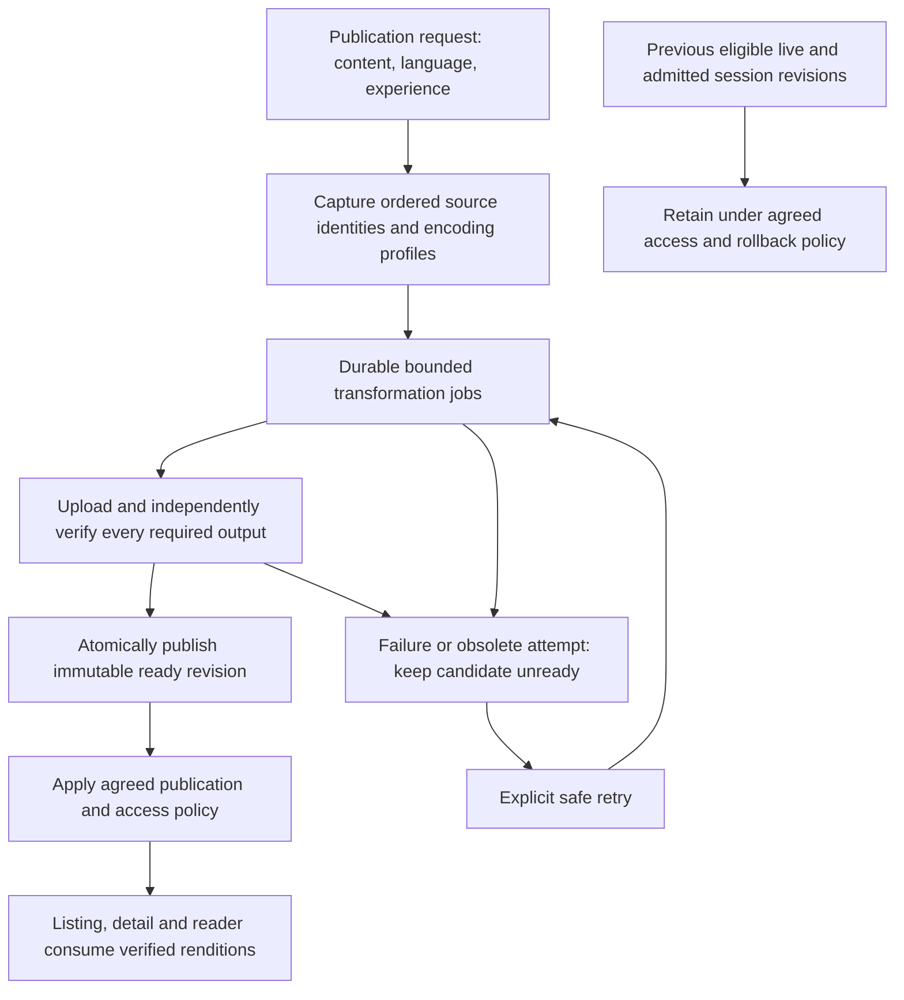

# Implementation Phases and Acceptance

Status: planning draft, 2026-10-08. Phases describe prospective independently reviewable work; they are not scheduled stories or implementation approval. Confirm the relevant open questions before starting each dependent phase. Notify the human before long implementation so model/reasoning settings can be adjusted.

## Intended publication boundary

This is the intended new delivery contract, not current behavior. Editorial publication may remain a separate state; the exact request/ready/live relationship is OQ-5. A new revision cannot become ordinarily deliverable before required optimization succeeds. Processing can be asynchronous; the CMS HTTP request need not perform conversion. Already verified source/profile outputs may be reused idempotently, subject to the agreed freshness/readiness contract. Do not re-encode on every GET or repeatedly degrade derivative inputs.

## P0 — Corpus and profile experiment

Select sources and device targets using `rendition-evaluation.md`. The first bounded local JPEG comparison is complete: [findings](p0-small-jpeg-findings.md) record 63 source/output pairs, size regressions and a separate pre-encode color diagnostic. This small-cover slice does not close P0. Add representative large originals, titles/pages, alpha/orientation/color and conditional codec alternatives. Agree role-specific quality, dimension, transfer and resource budgets, including small-source policy, before downstream implementation.

**Exit:** exact sample IDs/hashes, actual source/output pairs and device quality verdicts exist; profile decisions and remaining unsupported roles are recorded. The current small fixture inventory alone does not satisfy this gate.

## P1 — Revision/readiness contract

Define required roles per content type/language/experience and a ready revision containing observed asset metadata, source fingerprint and profile/encoder version. Preserve ADR-0010 source mapping: STORY textless source artwork is separate from localized reading and shared listening covers; LULLABY `listing_cover_media_id` supplies static list artwork while `listening_cover_media_id` supplies playback/detail artwork, potentially animated. Do not wire one generic cover job to all these fields. Specify captured processing ID, attempt, lease and source/profile ownership for successful and failed callbacks; job completion and ready-manifest publication must be atomic. Reuse the listing pattern and harden the page experiment. Account for source/profile changes, overlapping publish/retry requests, restart recovery and deduplicated work with database constraints.

Agree publication requests versus ready/live pointers and what existing `processingStatus` means. Enumerate create/update/status/mark-ready/admin commands so none can bypass new-contract readiness. Plan compatibility with legacy `DELIVERY` and original-asset consumers rather than treating old completion flags as proof. Preserve module directions; no content entity imports into asset internals or new cycles.

**Exit:** concrete examples cover new/unchanged/changed source/profile, first publish, failed replacement, stale success/failure and retained sessions. Record adopted durable changes in an ADR, project memory and canonical architecture before implementation. Proposed schema/API details remain undecided until these examples agree.

## P2 — Verified image generation

Extend existing listing/page conversion infrastructure for the agreed STORY reading cover, detail and page roles. Transform retained originals using bounded resources into immutable revision paths; verify stored MIME, bytes,checksum,dimensions and decoding before readiness. Preserve aspect ratio and agreed alpha/color/orientation behavior. No extension-only WebP entries, generic plan-only completion or partially ready multi-output revision qualifies.

Keep persistent jobs with bounded concurrency,retries,temporary storage and duration. Do not hold database transactions through source download or conversion. A lease/attempt fence remains necessary after timeout; cancelling a future alone is not proof that a worker stopped. Protect old live/session outputs; isolate partial/orphan objects and record cleanup ownership rather than deleting unrelated objects.

**Exit:** actual stored outputs exist for each required role; storage absence/corruption/partial-upload and codec/resource failures prevent readiness; duplicate/restarted workers are safe. Additional shared/static/animated artwork must pass its own role gates before broader coverage is claimed.

## P3 — Publish orchestration and editorial feedback

Connect a publication request to the durable required-role work and the agreed ready revision. Keep rendering/status composition separate from conversion. Surface preparation, failure and explicit retry in existing CMS patterns; reuse existing status/action primitives and limit any UI changes to the agreed workflow. Specify pending-first-publication versus failed-replacement behavior; previous eligible live content remains available under the chosen contract.

**Exit:** ordinary consumers cannot obtain a new unverified revision through any entry path; source changes invalidate affected readiness; unrelated language/experience scopes retain their correct state. Retry cannot promote obsolete output. CMS/backend integration proves the actual stored revision, not only status labels.

## P4 — Versioned consumers

Switch new detail Hero delivery to verified detail renditions and connect the new reader contract to verified page renditions. Keep listing/recommendation reuse, selected content language, server access and immutable cache identity intact. Metadata-only endpoints do not grant protected page/media access. Revalidate checksums,MIME,dimensions and request/attempt ownership; reject missing/unsupported renditions with the agreed state instead of a raw fallback. Preserve Story1.1/1.2 navigation, narration preference and bounded cache regressions.

**Exit:** real authenticated backend-to-client checks show rendition IDs and actual bytes for each admitted role, language,audience,phone/tablet and expiry/retry path. The controlled PoC can support P0 experiments; completing the production Story1.3 reader or full Epic5 workflow is not a prerequisite to begin P0. Production integration still requires the corresponding EXT-MEDIA/EXT-PUBLICATION/access contracts.

## P5 — Existing-content transition and rollout

The human approved new-publication enforcement first and a separately controlled existing-content backfill on 2026-10-08. Inventory role/source/profile/legacy readiness; dry-run exact planned outputs without writes, then regenerate a small selected cohort into new paths. Define when historical content becomes eligible through the new delivery contract without changing its existing admitted delivery prematurely. Verify source/output identity and all required roles before changing any new-contract pointer. Confirm rollback to the previous eligible revision, protecting admitted sessions and ordinary/candidate access.

Read-only production inventory and any production writes/deployment require their concrete operational scope at execution time. Preserve originals; do not mass overwrite storage paths, delete historical revisions or equate historical `COMPLETED` with certification. Define retention protecting live,rollback,active-session and pending-job references before orphan cleanup. Backfill and cleanup are independently reviewable jobs.

**Exit:** cohort decisions, verified metadata, error/retry rates,processing resources and client byte/quality measurements are recorded; rollback is demonstrated; expansion is explicit. Update Railway runbook/runtime codec verification when implementation affects deployment. No deployment or production mutation occurs in this planning task.

## Verification matrix for implementation

| Concern | Required evidence |
| --- | --- |
| Real encoding | Actual JPEG/PNG and any adopted codec fixtures; stored byte/MIME/hash/dimension/decode checks; aspect/title/color/alpha/orientation and animation cases |
| Publication/admission | First publication,pending/failed replacement,ordinary/tester/subscriber and exact-language/experience cases; no status/admin bypass or original fallback |
| Concurrency/recovery | Actual PostgreSQL constraints/transactions; duplicate requests,expired lease,restart,stale success/failure and source/profile replacement during processing |
| Integrity/storage | Missing/corrupt source/output,mismatched metadata,partial upload,unknown registry-only outputs and retry with protected retained revisions |
| Resource limits | Excess bytes/pixels/frames,slow converter,input full decode,temporary disk,concurrency and bounded worker teardown |
| Mobile | Cold/warm verified delivery,decoded sizing,expiry renewal,disposal,stale callback rejection,phone/tablet and small/text-dense images; Story1.1/1.2 regression |
| Migration | Dry-run correctness,small cohort,pointer atomicity,retained sessions,rollback and no source overwrite/deletion |

Run relevant focused tests, real PostgreSQL integration/Flyway coverage, Modulith verification and backend `bash ./mvnw verify` for the eventual backend change. Run analyzer,appropriate Flutter tests and actual device checks for client changes; CMS production build and focused interaction/regression checks for any CMS change. Unit mocks or a successful build do not replace actual converter/storage/publication evidence. This planning/local-experiment run does not claim new application test results or production readiness.
