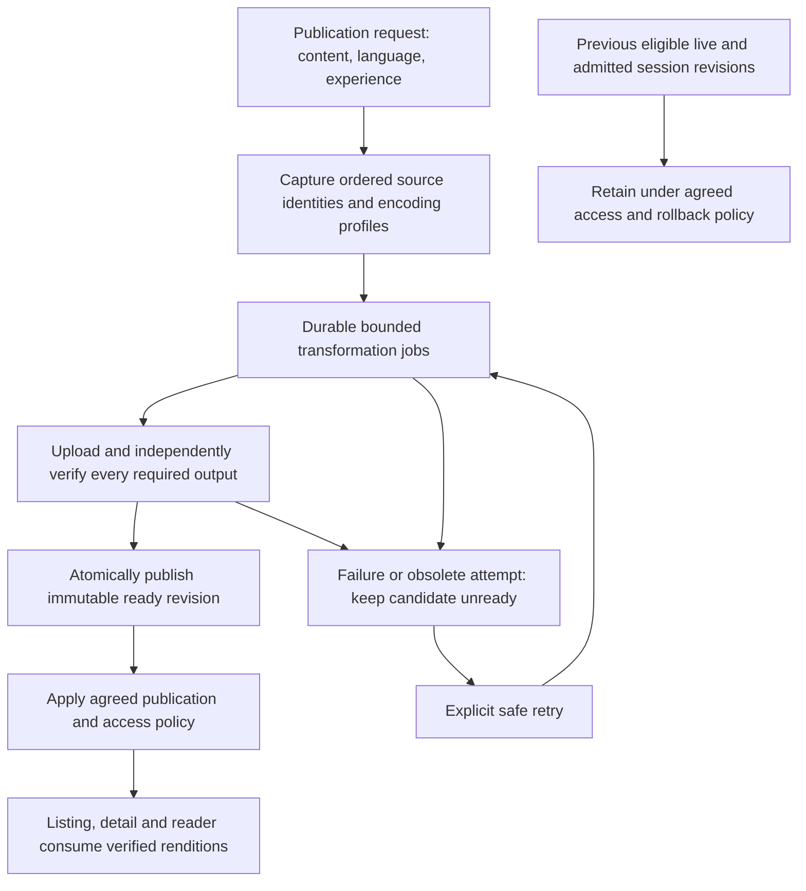

# Implementation Phases and Acceptance

Status: planning draft, 2026-10-08. Phases describe prospective independently reviewable work; they are not scheduled stories or implementation approval. Confirm the relevant open questions before starting each dependent phase. Notify the human before long implementation so model/reasoning settings can be adjusted.

## Intended publication boundary

This is the intended new delivery contract, not current behavior. Editorial publication may remain a separate state; the exact request/ready/live relationship is OQ-5. A new revision cannot become ordinarily deliverable before required optimization succeeds. Processing can be asynchronous; the CMS HTTP request need not perform conversion. Already verified source/profile outputs may be reused idempotently, subject to the agreed freshness/readiness contract. Do not re-encode on every GET or repeatedly degrade derivative inputs.

## P0 — Slot, corpus and resource qualification

Use `rendition-evaluation.md` and `client-image-contract.md`. The first bounded local JPEG comparison remains complete: [findings](p0-small-jpeg-findings.md) record 63 pairs, size regressions and a separate pre-encode color diagnostic. This slice does not close P0; the research adds no new converter/device benchmark.

| Slice | Concrete result | Acceptance evidence |
| --- | --- | --- |
| P0a — Slot and source qualification | Inventory actual listing/detail/reader/listening slots, logical/physical size, DPR, fit/alignment, source ratio/orientation and text-safe region. | Phone/tablet portrait/landscape, high DPR and window changes. Compare observed variant dimensions against two-axis fitted demand. Flag source shortage; preserve inherited framing. |
| P0b — Equal-geometry codec experiment | JPEG controls plus actual packaged WebP lossy/lossless and role-relevant PNG reference/candidates from identical normalized pixels. | Large masters, real pages/text/diacritics, lines/gradients, alpha, EXIF/ICC and small-JPEG controls; exact hashes/settings/runtime round-trip. No equal-q/universal-saving inference. |
| P0c — Native quality and resources | Identical journeys record actual transfer, decode dimensions, target-frame paint, peak/settled process/native memory and worker resources. | Physical constrained Android and oldest supported iPhone/iPad combinations plus modern controls; isolated cache states, raw failures and framing/legibility verdicts. Resolve OQ-6 for profile/release-equivalent entry without weakening current admission/release guard. |

Agree role-specific quality, dimensions, transfer, latency, decode/live/preload and worker bounds, including compliant-source policy, before dependent qualification. Read-time subsampling, one/two active decodes and current/current-plus-next reader windows are experimental arms, not approved configuration.

**Exit:** traceable slot/source/output/device records and native quality/resource verdicts exist; chosen profiles/budgets, compliant-source decisions and unsupported roles are recorded. The small fixture inventory, debug functional tests or a completed preload Future do not satisfy this gate.

## P1 — Revision/readiness contract

Define required roles per content type/language/experience and a ready revision containing observed asset metadata, source fingerprint and profile/encoder version. Preserve ADR-0010 source mapping: STORY textless source artwork is separate from localized reading and shared listening covers; LULLABY `listing_cover_media_id` supplies static list artwork while `listening_cover_media_id` supplies playback/detail artwork, potentially animated. Do not wire one generic cover job to all these fields. Specify captured processing ID, attempt, lease and source/profile ownership for successful and failed callbacks; job completion and ready-manifest publication must be atomic. Reuse the listing pattern and harden the page experiment. Account for source/profile changes, overlapping publish/retry requests, restart recovery and deduplicated work with database constraints.

Agree publication requests versus ready/live pointers and what existing `processingStatus` means. Enumerate create/update/status/mark-ready/admin commands so none can bypass new-contract readiness. Plan compatibility with legacy `DELIVERY` and original-asset consumers rather than treating old completion flags as proof. Preserve module directions; no content entity imports into asset internals or new cycles.

Resolve OQ-3 with explicit source/profile/quality and byte-acceptance examples: already compliant encoded bytes may be copied/referenced only if formally admitted as a verified immutable role/profile rendition. Research recommends avoiding unnecessary lossy generations; reuse and equal-size/growing-output success are not yet approved. Resolve OQ-4 normalization and OQ-5 protected HTTP cache/renewal/retention policy; signed URLs do not establish public/shared-cache eligibility. No CDN is required.

**Exit:** examples cover new/unchanged/changed source/profile, first publish, failed replacement, stale success/failure, compliant-source admission and retained-session/cache renewal. Record adopted durable changes in an ADR, project memory and canonical architecture before implementation. Proposed schema/API details remain undecided until these examples agree.

## P2 — Verified image generation

Extend existing listing/page conversion infrastructure for the agreed STORY reading cover, detail and page roles. Validate retained originals, normalize orientation/mirroring and explicit color/alpha semantics, resize once per output, encode/admit compliant bytes into immutable revision paths, then independently reread/verify stored MIME, bytes, checksum, dimensions and decoding. Do not repeatedly encode derivatives. Prove actual Java25/deployment provider/binary round-trip for any adopted codec; an extension, writer registry or successful build is insufficient. No plan-only completion or partially ready multi-output revision qualifies.

Keep persistent jobs with bounded source bytes, pixels/frames, heap/native/process/container memory, temporary disk, duration, retries and concurrency jointly with encoder threads. Full source raster allocations count; qualify read-time subsampling against full-decode quality controls before adopting it. Do not hold database transactions through download/conversion. A lease/attempt fence remains necessary after timeout; cancelling a future alone does not prove worker teardown. Protect old live/session outputs; isolate partial/orphan objects and record cleanup ownership rather than deleting unrelated objects.

**Exit:** actual stored outputs exist for each required role; storage absence/corruption/partial-upload and codec/resource failures prevent readiness; duplicate/restarted workers are safe. Additional shared/static/animated artwork must pass its own role gates before broader coverage is claimed.

## P3 — Publish orchestration and editorial feedback

Connect a publication request to the durable required-role work and the agreed ready revision. Keep rendering/status composition separate from conversion. Surface preparation, failure and explicit retry in existing CMS patterns; reuse existing status/action primitives and limit any UI changes to the agreed workflow. Specify pending-first-publication versus failed-replacement behavior; previous eligible live content remains available under the chosen contract.

**Exit:** ordinary consumers cannot obtain a new unverified revision through any entry path; source changes invalidate affected readiness; unrelated language/experience scopes retain their correct state. Retry cannot promote obsolete output. CMS/backend integration proves the actual stored revision, not only status labels.

## P4 — Versioned consumers

### P4a — Role and slot selection

Switch new detail Hero delivery to verified detail renditions and connect the new reader contract to verified page renditions. Select the smallest qualified manifest variant meeting actual fitted physical-pixel demand on both axes; bound aspect-preserving decoding without silently changing crop, DPR or source detail. Recompute rotation/window/layout changes with qualified target buckets. Shortage/rejection remains visible. Keep listing/recommendation reuse, selected language and server access intact; metadata endpoints do not grant protected media access. Revalidate checksums, MIME, dimensions and attempt ownership; no raw fallback.

### P4b — Residency and scheduling

Apply `client-image-contract.md`: prioritize visible work and bound transfers, decodes and decoded bytes in flight. Retain current cache limits as controls pending measured decisions. Discard obsolete queues, release listeners and preserve app/session disposal ownership, integrity, promotion, timeouts/retry and account-switch teardown. Separate encoded immutable account/access-scoped identity, decoded geometry/provider and transfer attempts; URL renewal must not fragment persistent identity. Precache/display share the final bounded provider and explicitly observe failure/retention. Verify transport cancellation rather than inferring it from cache eviction.

Measure churn, live/pending ownership and return-to-idle drift across Library/detail/future reader overlap. Pressure handlers offer cleanup, not guaranteed prevention; qualify proactive bounds. Enforce the agreed protected HTTP cache policy with admission/renewal, without copying public long-lived policies into protected media. Preserve Story1.1/1.2 navigation, narration preference and bounded cache regressions.

**Exit:** real authenticated checks trace rendition IDs, actual bytes, decode selection, visible frame and resource behavior for each admitted role, language, audience, phone/tablet and expiry/retry path. Qualify high-DPR/tall/wide/short-source cases and scripted overlap/lifecycle failures. The PoC may support bounded P0 work; its unbounded image path is not production acceptance and the controlled Library entry cannot silently become a release harness. Completing Story1.3/full Epic5 is not required to begin P0. Production integration still requires EXT-MEDIA/EXT-PUBLICATION/access contracts.

## P5 — Existing-content transition and rollout

The human approved new-publication enforcement first and a separately controlled existing-content backfill on 2026-10-08. Inventory role/source/profile/legacy readiness; dry-run exact planned outputs without writes, then regenerate a small selected cohort into new paths. Define when historical content becomes eligible through the new delivery contract without changing its existing admitted delivery prematurely. Verify source/output identity and all required roles before changing any new-contract pointer. Confirm rollback to the previous eligible revision, protecting admitted sessions and ordinary/candidate access.

Read-only production inventory and any production writes/deployment require their concrete operational scope at execution time. Preserve originals; do not mass overwrite storage paths, delete historical revisions or equate historical `COMPLETED` with certification. Define retention protecting live, rollback, active-session and pending-job references before orphan cleanup. Backfill and cleanup are independently reviewable jobs.

**Exit:** cohort decisions, verified metadata, error/retry rates, resources and client byte/quality measurements are recorded; separate all-variant storage totals from actual journey transfer. Rollback is demonstrated; expansion is explicit. Update Railway runbook/runtime codec verification when implementation affects deployment. No deployment or production mutation occurs in this planning task.

## Verification matrix for implementation

| Concern | Required evidence |
| --- | --- |
| Real encoding | Actual JPEG/PNG and any adopted codec fixtures; stored byte/MIME/hash/dimension/decode checks; aspect/title/color/alpha/orientation and animation cases |
| Publication/admission | First publication, pending/failed replacement, ordinary/tester/subscriber and exact-language/experience cases; no status/admin bypass or original fallback |
| Concurrency/recovery | Actual PostgreSQL constraints/transactions; duplicate requests, expired lease, restart, stale success/failure and source/profile replacement during processing |
| Integrity/storage | Missing/corrupt source/output, mismatched metadata, partial upload, unknown registry-only outputs and retry with protected retained revisions |
| Resource limits | Excess bytes/pixels/frames, slow converter, full raster/subsampling controls, heap/native/RSS/container, temp disk, encoder threading/concurrency and worker teardown |
| Mobile geometry/quality | Actual slot/DPR/fit/alignment, manifest dimensions, tall/wide/text/alpha, source shortage, rotation/window changes and preserved framing; Story1.1/1.2 regression |
| Mobile residency/lifecycle | Verified network-cold/disk-warm decoded-cold/memory-warm;live/pending owners, rapid scroll/reversal, detail/back/page overlap, expiry, corruption/offline, account switch, background/resume and separately labeled synthetic pressure |
| Native measurement | Qualified profile/release-equivalent physical-device entry, exact engine/renderer/tools, actual target-frame association or explicit unavailable result, raw failures, peak/settled process/native memory without overlapping-counter addition |
| Protected HTTP cache | Response policy and exact client behavior for private/no-cache/no-store, renewal/access/retention; signed URL or ETag alone is insufficient |
| Migration | Dry-run correctness, small cohort, pointer atomicity, retained sessions, rollback and no source overwrite/deletion |

Run relevant focused tests, real PostgreSQL integration/Flyway coverage, Modulith verification and backend `bash ./mvnw verify` for the eventual backend change. Run analyzer, appropriate Flutter tests and actual device checks for client changes; CMS production build and focused interaction/regression checks for any CMS change. Unit mocks or a successful build do not replace actual converter/storage/publication evidence. This planning/local-experiment run does not claim new application test results or production readiness.
